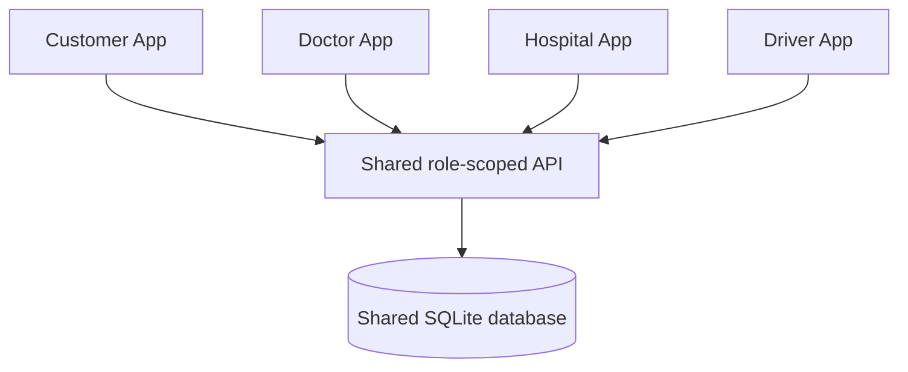

# One database, four independent clients

Database: data/healthbasket.sqlite3, created automatically on first server run.
Schema: schema.sql. One Python sqlite3 connection factory; request transactions share the same file. Foreign keys are enabled on every connection.

| Table | Shared responsibility / principal relations |
| --- | --- |
| hospitals | Common hospital master, HOSP-001 through HOSP-003 |
| services | Common service codes |
| hospital_services | Hospital/service availability mapping |
| users | Independent customer/doctor/hospital/driver identities; hospital staff scoped to hospital_id |
| user_profiles | Own-user profile metadata; Doctor profile persisted here |
| sessions | Opaque expiring API session tokens linked to users |
| driver_profiles | Driver/vehicle/service base/online state, linked to users |
| requests | Customer/hospital/assigned driver/service/stage/revision and shared request payload |
| referrals | Doctor-to-hospital care submissions and explicit care status |
| payments | One simulated gateway collection per request; amount and customer linkage |
| driver_claims | One claim per completed trip, linked to driver and request |
| events | Timestamped actor, customer, hospital, request and event text |
| documents | Prescription BLOB and metadata linked to owner and request |
| ledger_records | Separate hospital-direct receipt, sample bill-payment and customer-benefit records |

Canonical IDs are consistent across apps. A hospital display name is not a join key. The client compatibility bridge recognises legacy display names, but the server resolves and stores the canonical hospital_id and validates service availability.

Request-specific form fields, original UI timeline and provider metadata are kept in JSON payloads alongside indexed relational identity/stage columns. Financial collection and driver claim amounts are also kept in their dedicated tables. This is a pragmatic demo schema, not a complete hospital HIS schema or a production accounting ledger. Formal schema migrations and strongly typed additional fields are a next-development task.

The Customer and Doctor approved interfaces are retained as clients, but their shared core state comes from the API. Some legacy Doctor appearance/security/member-preview preferences and generated local document previews remain client-side; they do not become clinical/bank evidence. Existing browser-only sample history is not imported into this new database.

Back up the database only with the server stopped, or use SQLite's backup API for a live backup. Do not distribute a database containing actual patient or financial data. The ZIP intentionally includes no QA/populated database. To start a fresh DEMO database, stop the server, back up/rename data/healthbasket.sqlite3, then restart. This does not migrate or merge old files.
